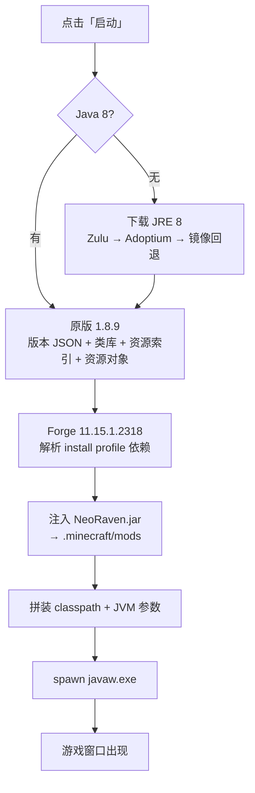

<div align="center">


# NeoRavenLauncher

**为 NeoRaven 客户端打造的桌面启动器** · Minecraft 1.8.9 / Forge 11.15.1.2318


</div>

---

## 目录

- [截图](#截图)
- [这是什么](#这是什么)
- [关于 AI 参与](#关于-ai-参与)
- [功能](#功能)
- [原理](#原理)
- [技术栈](#技术栈)
- [目录结构](#目录结构)
- [快速开始](#快速开始)
- [开发与构建](#开发与构建)
- [配置项](#配置项)
- [常见问题](#常见问题)
- [隐私](#隐私)
- [免责声明](#免责声明)

---

## 截图

<table>  
<tr>  
<td width="50%" align="center">   <sub><b>主页</b>：启动按钮 + 版本选择 + 欢迎语</sub></td>  
<td width="50%" align="center">   <sub><b>设置</b>：单一主题色，界面与图标同步</sub></td>  
</tr>  
<tr>  
<td width="50%" align="center">   <sub><b>运行参数</b>：Material 滑条、开关、Java 探测</sub></td>  
<td width="50%" align="center">   <sub><b>启动成功</b>：游戏窗口正常出现，客户端已注入</sub></td>  
</tr>  
</table>

|                                                                        启动完成后的启动器                                                                        |
| :-----------------------------------------------------------------------------------------------------------------------------------------------------: |
| <br /><sub>状态栏显示 <code>Minecraft 1.8.9 · NeoRaven 已启动（Steve）</code>，启动器保持可见、不会自动最小化</sub> |

---

## 这是什么

NeoRaven 是一个 Minecraft 1.8.9 的 Forge 客户端模组（jar），官方只发布模组本体。**NeoRavenLauncher 是它的桌面外壳**：把"装 Java、下原版、装 Forge、注入模组、拼命令行、起进程"这一整套手动流程压成一个按钮。

启动器本身不含游戏内容，它做的是**环境编排**：

```
你的电脑  →  Java 8 运行时  →  原版 1.8.9  →  Forge  →  NeoRaven.jar  →  游戏窗口
              (自动下载)      (自动下载)     (自动部署)   (自动注入)      (自动拉起)
```

首次启动需要下载约 1 GB 资源；在国内网络下走 BMCLAPI 镜像，实测 **45 秒** 完成原版 + Forge 全量部署。

---

## 关于 AI 参与

这个项目是 **AI 结对编程（AI pair programming）的产物**，请以此为前提阅读和使用。

- **参与方式**：从需求拆解、架构选型、Electron 主进程逻辑、React 渲染层、样式动效，到这份 README，全部由作者与大模型代码智能体（WorkBuddy 内置 Agent）协作完成。人负责提需求、验收和拍板，AI 负责写码、调试、定位问题。
- **验证程度**：所有关键路径都在真机上跑过并留了证据 —— 游戏窗口截图、`boot.log` 启动时序、HWID 云端读写结果、安装包静默安装后启动。
- **已知局限**：AI 生成的代码不等于正确代码。遇到过的问题（例如 `java.exe` 导致游戏窗口不出现、GitHub 直连限速误判为"卡死"）都写进了下面的[原理](#原理)与[常见问题](#常见问题)，但**仍可能存在未发现的边界情况**。
- **使用建议**：把它当作"能跑的参考实现"。发布到自己的环境前，建议通读 `electron/core/` 下的启动链路代码，按需替换账号体系与更新源。

---

## 功能

### 界面

- **小窗口横向布局**：920×560 起，圆角矩形卡片，纯平面无描边，无系统标题栏（自绘标题栏 + 原生按钮图标）。
- **可收起侧栏**：默认只显示图标，悬停展开文字；折叠态图标严格居中对齐，展开时以 `gap` 过渡，不会"跳一下"。
- **原生亚克力**：Windows 11 走 DWM `acrylic` 材质，macOS 走 `NSVisualEffectView`，Windows 10 / 无材质环境自动降级为 CSS 玻璃层。
- **Material Design 3 控件**：`Slider` / `Switch` / 涟漪反馈 / `cubic-bezier(0.2, 0, 0, 1)` 强调曲线，动效时长 120–320ms 分档。

### 主题

- **单一主题色**：只有一处"主题色"，改一次同时作用于**界面强调色、窗口左上角图标、桌面/开始菜单快捷方式图标**，不存在"UI 变了图标没变"。
- 即时生效（先改 DOM 变量再加 260ms 防抖落盘），拖色板时没有卡顿感。
- 内置 MUI 原色板预设 + 自定义取色器。

### 启动

- **一键部署**：Java 8 → 原版 1.8.9 → Forge → 客户端模组 → 启动，五阶段进度 + 实时日志。
- **Java 自动探测**：扫描常见安装路径（Zulu / Liberica / Temurin / Oracle / Microsoft），找不到就自动下载。
- **崩溃可读**：游戏存活 < 12 秒且非 0 退出时，直接提示"启动后立即崩溃"，并指向日志里的红字报错。
- **不抢窗口**：默认启动后**不**最小化启动器，可选项在设置里。

### 版本与身份

- **启动自检更新**：拉 GitHub Release 列表，与本地版本比对，新版本自动下载 jar 并应用；也可手动在版本列表里切换。
- **云端机器码身份**：首次启动自定义用户名，之后按机器码自动识别；用户名与机器码写入云端，重装系统/换机后仍能找回。

---

## 原理

### 1. 进程分层

渲染层拿不到任何 Node 能力，全部能力经 `preload` 的 `contextBridge` 白名单暴露：

```
┌──────────────────────────────────────────────┐
│ Renderer (React + MUI)   contextIsolation:on │
│   无 require / 无 fs / 无 child_process       │
└───────────────┬──────────────────────────────┘
                │ window.api.*（preload 白名单）
┌───────────────▼──────────────────────────────┐
│ Main (Node)  IPC → core/*                     │
│  settings  download  java  vanilla  forge     │
│  launch    updates   icon   hwid   cloud      │
└──────────────────────────────────────────────┘
```

好处是渲染层即使被注入任意脚本，也无法直接执行系统命令；所有危险操作都收敛在 `electron/core/` 里。

### 2. 游戏是怎么被拉起来的



几个关键点：

- **classpath 并集**：原版类库 ∪ Forge 类库 ∪ 客户端 jar，按 `group:artifact` 去重，后写覆盖前写，避免同库多版本打架。
- **离线 UUID**：`md5("OfflinePlayer:" + 用户名)`，再按 RFC 4122 改写版本位与变体位 —— 和原版离线模式一致，皮肤/存档才认得同一个人。
- **JVM 参数**：`-Xmx/-Xms` + G1 三件套（`G1NewSizePercent=20`、`G1ReservePercent=20`、`MaxGCPauseMillis=50`）+ `-Djava.library.path` 指向解压后的 natives。
- **启动前自检**：拼完命令行后遍历 classpath，缺哪个 jar 直接在界面报"缺少 N 个必要依赖"，而不是让游戏抛一个看不懂的 `NoClassDefFoundError`。

### 3. 为什么必须用 `javaw.exe`（这是个真坑）

最初的实现用 `java.exe` 启动，并给 `spawn` 设了 `windowsHide: true`（本意是别弹黑框）。结果：**进程在、CPU 在占、就是没有游戏窗口**。

排查结论：

| 启动方式                                   | 结果                                                |
| -------------------------------------- | ------------------------------------------------- |
| `java.exe` + `windowsHide: true`       | 只创建 `__wglDummyWindowFodder` 占位窗口，GL 上下文无法附着到可见窗口 |
| `java.exe` + `windowsHide: false`      | 能出窗口，但伴随一个常驻控制台黑框                                 |
| **`javaw.exe` + `windowsHide: false`** | **窗口正常，无黑框**                                      |

`java.exe` 属于控制台子系统，被隐藏后进程没有可用的控制台窗口，LWJGL 2.x 在创建 GL 上下文时退化到 dummy window。改用 GUI 子系统的 `javaw.exe` 后问题消失。现在的代码会在 Windows 下自动把 `...\bin\java.exe` 换成同目录的 `javaw.exe`：

```js
let javaExe = java.path
if (process.platform === 'win32' && /java\.exe$/i.test(javaExe)) {
  const javaw = path.join(path.dirname(javaExe), 'javaw.exe')
  if (fs.existsSync(javaw)) javaExe = javaw
}
const child = spawn(javaExe, args, { cwd: settings.gameDir, windowsHide: false, ... })
```

### 4. 下载加速：BMCLAPI 镜像 + 官方回退

Mojang 的 `libraries.minecraft.net` / `resources.download.minecraft.net` 在国内经常只有几十 KB/s。`download.js` 里维护了一张改写表，**镜像优先、官方兜底**（镜像 404 会自动回退，不会因为镜像缺文件而卡死）：

| 原始域名                                                    | 镜像改写                              |
| ------------------------------------------------------- | --------------------------------- |
| `libraries.minecraft.net`                               | `bmclapi2.bangbang93.com/maven/`  |
| `resources.download.minecraft.net`                      | `bmclapi2.bangbang93.com/assets/` |
| `piston-meta.mojang.com` / `launchermeta`               | `bmclapi2.bangbang93.com/`        |
| `maven.minecraftforge.net` / `files.minecraftforge.net` | `bmclapi2.bangbang93.com/maven/`  |

每个 URL 展开成候选列表 `[镜像, 官方]`，外层遍历候选、内层重试（超时 180s），任何一个下载器都走同一套逻辑，包括版本 JSON 的 `getJson`。

### 5. 客户端更新：读 Release，换一个 jar

更新源就是 NeoRaven 仓库的 GitHub Release（资产是 `NeoRaven1.0.0.jar` 这类模组包，不是安装器）：

```
启动 → GET /repos/Matr1ze/NeoRaven/releases
     → 取 tag 做版本比较（1.0.10 > 1.0.9，按段数值比较而非字符串）
     → 下载资产到  <root>/clients/<version>/NeoRaven.jar
     → 复制一份到 <gameDir>/mods/NeoRaven.jar
     → 启动时优先用缓存里最新的那份
```

两个工程细节：

- **镜像链**：GitHub 直连实测 15 KB/s（7.4 MB 要 8 分钟），改成 `gh-proxy.com` 优先（实测 890 KB/s）、`ghproxy.net`、`mirror.ghproxy.com` 依次回退、最后直连。
- **看门狗按"无进度"计时**：一开始是"总共 90 秒超时"，结果慢速下载被误判成"卡死"。现在每收到一次进度就重置计时器，连续 60 秒没有任何字节才报超时 —— 检测耗时从 90s 降到 **0.3s**（命中缓存时）。

### 6. 身份：HWID 是算出来的，不是读出来的

很多启动器用 `reg.exe` / `wmic` 读主板序列号 —— 这会触发杀软行为拦截，还会因为权限不足拿到空值。这里改成纯 Node：

```js
sha256([platform, hostname, 首块物理网卡 MAC, CPU 型号, 总内存].join('|')).slice(0, 24)
```

- 信号源全部来自 `os` 模块，**不调外部命令**，不会被拦截，也不需要管理员权限。
- 只输出 **24 位十六进制**（96 bit），不可逆推原始硬件信息；界面上再降级显示为 `bf5449…66df`。
- 本地优先：设置里永远有可用用户名，云端只做"重装/换机后按机器码找回"。

云端用 WorkBuddy Cloud 的 PostgREST 风格接口，一张表搞定：

```sql
nr_users(hwid TEXT PRIMARY KEY, username TEXT, updated_at TIMESTAMPTZ)
```

写入是 `upsert(..., { onConflict: 'hwid' })`，读取是 `select('username').eq('hwid', hwid).maybeSingle()`。云端失败不会阻塞启动，只是退回本地用户名。

### 7. 动态图标：一处改色，三处生效

改主题色时，需要同时改**窗口图标**和**桌面快捷方式图标**。难点在快捷方式——Windows 没有提供 Node 侧的 API。

```
颜色 → SVG 渲染 → 256×256 PNG (nativeImage)
                ├→ BrowserWindow.setIcon()            窗口左上角
                ├→ PNG-in-ICO 写入 icons/neoraven-<hex>.ico
                │    ├→ 复制为 resources/neoraven-custom.ico   任务栏/文件图标
                │    └→ WScript.Shell 改 .lnk 的 IconLocation    桌面/开始菜单
                └→ 设置里持久化 accent
```

- **PNG-in-ICO**：Vista 之后的 ICO 允许直接内嵌 PNG，只需 6 字节文件头 + 16 字节目录项 + PNG 数据，比手写 BMP 多尺寸省事且支持透明。
- **不跟手是怎么解决的**：原来串行等 PowerShell 改快捷方式（超时 20s），UI 卡在"正在应用"。改成两阶段：先设窗口图标并立即返回，快捷方式在后台异步刷，改色手感变成即时。
- 快捷方式刷新后调 `ie4uinit.exe -show` 让资源管理器重读图标缓存。

### 8. 亚克力：窗口属性错了就全白搭

Windows 11 的系统亚克力有个反直觉约束：**窗口本体不能是 layered window**。所以：

| 平台                        | 配置                                                                                      |
| ------------------------- | --------------------------------------------------------------------------------------- |
| Windows 11（Build ≥ 22621） | `backgroundMaterial: 'acrylic'` + `transparent: false` + `backgroundColor: '#00000000'` |
| Windows 10                | `transparent: true` + `backgroundColor: '#121014'` + CSS `backdrop-filter`              |
| macOS                     | `vibrancy: 'under-window'` + `visualEffectState: 'active'`                              |

|                                      |      |                                      |
| ------------------------------------ | ---- | ------------------------------------ |
| CSS 侧用 \`html[data-material="acrylic | blur | vibrancy"]\` 分档，同一套样式在三种材质下都不会糊成一片灰。 |

---

## 技术栈

| 层  | 选型                                 | 作用              |
| -- | ---------------------------------- | --------------- |
| 壳  | Electron 33                        | 主进程、原生窗口材质、IPC  |
| UI | React 18 + MUI 6 + Emotion         | 组件与主题系统         |
| 动效 | framer-motion 11 + CSS transition  | 页面切换、侧栏展开、涟漪    |
| 构建 | Vite 5                             | 渲染层打包           |
| 打包 | electron-builder 25（NSIS / dmg）    | 安装程序与磁盘映像       |
| 云  | WorkBuddy Cloud SDK                | 用户名 ↔ 机器码       |
| 资源 | Node `https` / `fs.promises` 自研下载器 | 镜像改写、并发、重试、进度节流 |

> 打包时用 `@electron/fuses` 关掉了 `EnableEmbeddedAsarIntegrityValidation` 与 `OnlyLoadAppFromAsar`（`build/afterPack.js`），否则自定义安装包会出现"进程在、窗口不显示"。这是 electron-builder + 自定义 asar 的已知组合坑。

---

## 目录结构

```
neoraven-launcher/
├─ electron/
│  ├─ main.js              窗口（材质/尺寸/单实例）、IPC 注册、更新调度
│  ├─ preload.js           contextBridge 白名单 API
│  └─ core/
│     ├─ settings.js       配置读写（原子写入、目录联动、默认根目录选 D/E/F 盘）
│     ├─ download.js       镜像改写、并发下载、重试、进度节流
│     ├─ java.js           Java 8 探测 + 自动下载（Zulu/Adoptium/Liberica…）
│     ├─ vanilla.js        1.8.9 版本 JSON、类库、natives、资源索引
│     ├─ forge.js          Forge install profile 解析与依赖部署
│     ├─ launch.js         参数拼装、classpath 并集、javaw 拉起、退出诊断
│     ├─ updates.js        GitHub Release 比对、镜像下载、应用 jar
│     ├─ icon.js           PNG→ICO、窗口图标、快捷方式图标
│     ├─ hwid.js           纯 Node 硬件指纹
│     └─ cloud.js          用户名 ↔ 机器码云端表
├─ src/
│  ├─ App.jsx              页面骨架、设置同步、图标联动
│  ├─ theme.js             MUI 主题与色板
│  ├─ styles.css           布局、动效曲线、材质分档
│  ├─ components/          TitleBar / SideRail / LaunchButton / LogConsole / Logo / ui
│  └─ pages/               HomePage / SettingsPage（另有 Appearance / Paths / Advanced / About
│                          为早期分页实现，当前版本未挂载，保留作参考）
├─ build/                  图标、许可证、NSIS 片段、dmg 背景、afterPack 钩子
├─ tools/                  自检脚本（云端连通、真实启动、窗口截图、源码打包）
└─ docs/screenshots/       README 用截图
```


---

## 快速开始

1. 到 [Releases](../../releases) 下载 `NeoRavenLauncher-1.0.1-setup.exe`。
2. 运行安装程序 —— 安装向导包含许可协议、**为所有用户 / 仅为我安装**、安装路径选择，装完自动创建桌面与开始菜单快捷方式，控制面板里有独立卸载项。
3. 首次启动会要求输入用户名（之后按机器码自动识别）。
4. 点「启动」。首启动会自动准备 Java 8、原版 1.8.9 和 Forge（约 1 GB，国内走镜像约 45 秒），之后再启动是秒开。

> 默认数据根目录选在 **D:\NeoRaven**（不存在则依次试 E:\、F:\，都没有才落到 `%APPDATA%`），避免 C 盘被 `.minecraft` 吃掉。路径全部可在设置里改。

macOS 用户：`npm run dist:mac` 在 Mac 上产出 dmg（electron-builder 无法在 Windows 上交叉打 dmg）。

---

## 开发与构建

```bash
npm install

npm run dev           # 仅渲染层，浏览器预览（无 Electron 能力）
npm start             # 构建渲染层 + 以 Electron 启动
npm run pack          # 免安装目录 → dist/win-unpacked
npm run dist:win      # Windows NSIS 安装包 → dist/NeoRavenLauncher-<ver>-setup.exe
npm run dist:mac      # macOS dmg（x64 + arm64），需在 macOS 上执行
```

自检脚本（需要先构建渲染层）：

```bash
node tools/test-cloud.js "D:/NeoRaven"        # HWID 生成 + 云端读写连通性
node tools/test-launch.js "D:/NeoRaven"       # 真实拉起游戏，60s 后回收
node tools/test-launch-chain.js "D:/NeoRaven" # Java→原版→Forge 全链路计时
node tools/make-source-zip.js out.zip          # 打源码包（排除 node_modules/dist）
```

调试钩子（仅开发期，通过环境变量注入）：

| 变量 | 作用 |
| --- | --- |
| `NRL_BOOTLOG=1` | 启动时序写入 `userData/boot.log` |
| `NRL_PAGE=settings` | 直接打开指定页面 |
| `NRL_SCROLL=520` | 内容区滚动到指定位置（截图自检用） |
| `NRL_EVAL="..."` | 在渲染层执行一段 JS（自动化点击/断言） |
| `NRL_NO_CLOUD=1` | 跳过云端查找，模拟首次启动 |

---

## 配置项

配置存放在 `%APPDATA%/NeoRavenLauncher/launcher-settings.json`（原子写入，不会写坏）：

| 键 | 默认值 | 说明 |
| --- | --- | --- |
| `accent` | `#FF9BB2` | 主题色，同时决定图标色 |
| `rootDir` | `D:\NeoRaven` | 数据根目录 |
| `gameDir` | `<root>\.minecraft` | 游戏文件夹 |
| `resourcePacksDir` / `savesDir` / `modsDir` / `screenshotsDir` | 随 `gameDir` 联动 | 子目录 |
| `memoryMb` | `4096` | 内存分配（1024–8192，512 步进） |
| `jvmArgs` | `-XX:+UseG1GC -Dfile.encoding=UTF-8` | 追加 JVM 参数 |
| `width` / `height` / `fullscreen` | `1280` / `720` / `false` | 游戏窗口 |
| `username` / `hwid` | 空 | 身份，首次启动后写入 |
| `clientVersion` | 空 | 当前使用的客户端版本（对应 `clients/<ver>/`） |
| `autoUpdate` | `true` | 启动时自动检查 GitHub Release |
| `closeOnLaunch` | `false` | 启动后是否隐藏启动器（默认不隐藏） |

---

## 常见问题

**点了启动，游戏窗口不出现？**
1.0.0 的 bug，已在 1.0.1 修复（`java.exe` → `javaw.exe`，见 [原理](#原理) 第 3 节）。若仍然不出现：看窗口是否在别的窗口后面（启动日志里会提示），或者展开启动日志看有没有 `Error: Could not create the Java Virtual Machine`。

**卡在"正在同步游戏资源"？**
走 BMCLAPI 镜像，正常几十秒。若长时间零进度，检查是否被代理软件拦截（`bmclapi2.bangbang93.com`）。

**提示"未检测到 Java"？**
设置 → Java 运行时 → 自动下载 Java 8；或手动指定 `...\bin\java.exe`（会自动换成同目录 `javaw.exe`）。

**更新检查很久没反应？**
现在只在"连续 60 秒零字节"时才报超时，正常情况下命中本地缓存 0.3 秒结束。首次下载 7.4 MB 客户端走 gh-proxy，约 10 秒。

**重装系统后名字变回默认了？**
换机后 HWID 会变（网卡/主机名变了），云端就找不到旧记录。这是设计取舍：不读取任何可被追踪的硬件序列号。

**内存给多少合适？**
1.8.9 用 2–4 GB 足够。分配越大反而 GC 停顿变长，超过 8 GB 对 1.8.9 没有收益。

---

## 隐私

- **本地**：只在 `launcher-settings.json` 里存主题、路径、内存、用户名等设置，不写入任何游戏账号密码（登录走离线模式）。
- **云端**：只上传 `hwid`（不可逆哈希）与 `username` 两列，用途仅限"重装后找回名字"。代码在 `electron/core/cloud.js`，可在设置或源码里关掉（云端失败自动降级为本地）。
- **无遥测**：不收集行为数据、不上报崩溃、不埋点。

---

## 免责声明

- 本项目是 **NeoRaven 客户端的第三方启动器**，与 Mojang、Microsoft、NeoRaven 官方**无隶属关系**，未获其背书。
- 项目**不包含**任何 Minecraft 游戏资源，所有原版文件均在运行时从官方/镜像源下载，需遵守 [Minecraft EULA](https://www.minecraft.net/eula)。
- NeoRaven 属于修改客户端。在多人服务器使用可能违反该服务器规则，账号风险由使用者自行承担，作者不承担任何后果。
- 本项目按 **MIT** 许可发布（见 `package.json`），代码"按原样"提供，不附带任何担保。

<div align="center">
<sub>Built with Electron · React · MUI — and a lot of AI pair programming.</sub>
</div>
